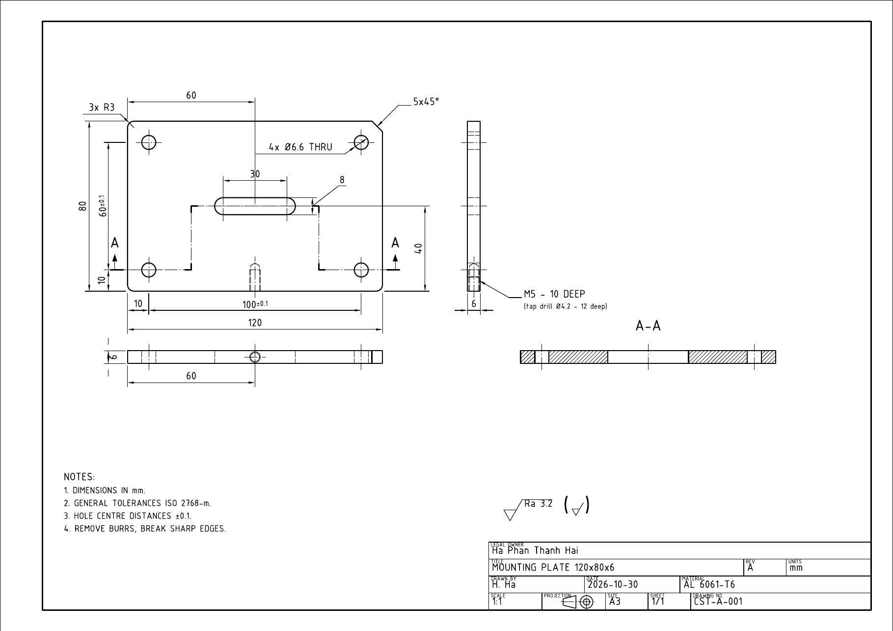
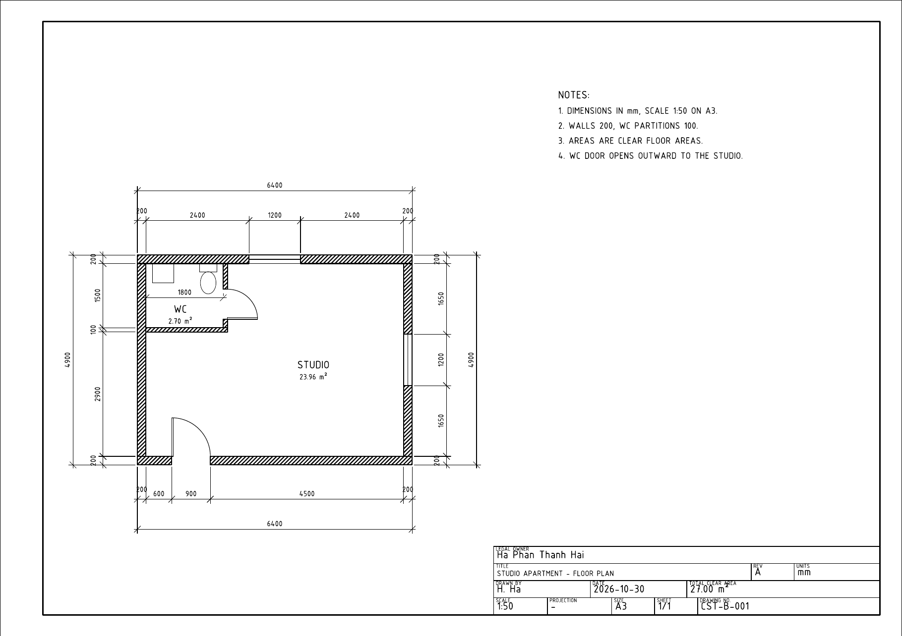

# CAD sample tests

Owner: Ha Phan Thanh Hai (GitHub `haiha-ux`). Two 2D drafting tests of the kind commonly requested on freelance platforms. Test A is a mechanical detail drawing to ISO, and test B is a simple architectural floor plan. Each drawing comes as DXF (R2018), DWG (AutoCAD 2018 format) and an A3 PDF, all generated by scripts in `tools/`.

| Test | Files |
|---|---|
| A — mounting plate 120×80×6, AL 6061, 1:1 | `bai_a/CST-A-001_mounting_plate.{dxf,dwg,pdf}` |
| B — studio floor plan, 1:50 | `bai_b/CST-B-001_studio_plan.{dxf,dwg,pdf}` |

| Test A — mounting plate (ISO) | Test B — studio floor plan 1:50 |
|---|---|
|  |  |

## Toolchain

| Step | Tool |
|---|---|
| Geometry, dimensions, hatches, title block | **ezdxf 1.4.3** (Python). Every dimension is a real `DIMENSION` entity with an ISO/architectural dimension style, not line + text. |
| PDF | ezdxf *drawing* add-on, **PyMuPDF backend**, A3 page at true scale (1:1 and 1:50). Lineweights are taken from the layers; text uses the ISO font `isocpeur.ttf`. |
| DWG | **ODA File Converter 27.9** (DXF → DWG ACAD2018). |

AutoCAD was not used. Every file is produced by the open-source or free tools above, so anyone can rebuild the whole set from the scripts.

ODA describes File Converter as a "free application". The installer ships no separate EULA, so I could not read its commercial terms. Confirm the ODA terms before using it for paid work.

### How the output was checked

Each script asserts the geometry and dimensions on every run. It checks the written file against the spec: hole centres and diameters, the measurement of every dimension, the two ±0.1 tolerance dimensions, door radii, window positions, room areas, and layer lineweights and linetypes. Any drift fails the build.

`ezdxf.audit()` reports 0 errors for both DXF files.

For the DWG round trip, I converted each DWG back to DXF with ODA and compared entity counts. Nothing was lost in the conversion.

- A: 15 DIMENSION, 8 CIRCLE, 1 HATCH, 2 LEADER, ...
- B: 25 DIMENSION, 2 door ARC, 1 HATCH, ...

I also rasterised the PDFs and inspected them by eye for overlaps and readability.

## Test A: mounting plate (ISO, first-angle projection)

The drawing has a front view, a plan placed below it and a left-side view placed to the right, per the first-angle method (ISO 5456-2, symbol in the title block). Through holes and the slot are shown in hidden lines in the plan and side views, and the blind tapped hole in the front and side views. All holes, the slot and the tapped hole have centre lines.

Section A-A uses an offset (stepped) cutting plane at y = 10 through the two lower Ø6.6 holes, stepping to y = 40 through the slot. No single straight plane passes through both the slot and a pair of holes, because the holes are at y = 10/70 and the slot is at y = 40. The cutting line is thick at the ends and at each change of direction, with arrows for the viewing direction. The section is hatched with ANSI31, and the steps are not drawn in the section, per ISO 128-50.

Dimensions follow ISO 129, with dimension style `ISO-A` and 3.5 mm text:

- overall 120 / 80, and thickness 6 in two views;
- hole positions 10 + 100±0.1 and 10 + 60±0.1, which are real dimension tolerances (`DIMTOL`), not typed text;
- slot position 60 / 40, slot length 30 between centres and width 8;
- `4x Ø6.6 THRU`, `3x R3`, `5x45°`;
- tapped hole position 60 and `M5 - 10 DEEP`.

General tolerances are ISO 2768-m. The general surface texture requirement sits next to the title block in the ISO 1302 form `✓Ra 3.2 ( ✓ )`. The title block is in ISO 7200 style: legal owner, title, material AL 6061-T6, scale 1:1, drawn by "H. Ha", date, drawing number, sheet, size and projection symbol.

The layers are OUTLINE 0.50, HIDDEN 0.25 DASHED, CENTER 0.18 CENTER, DIM, TEXT, TITLE and HATCH. The linetype patterns follow ISO 128-2 proportions (dash 3, gap 0.75). The two small hidden thread circles in the plan view have a per-entity linetype scale of 0.4. At full scale their perimeter of about 13-16 mm fits only 3-4 dashes, so they read as solid lines. Lineweights measured in the PDF are 0.50 mm → 1.42 pt, 0.25 mm → 0.71 pt and 0.18 mm → 0.51 pt, which is the ISO 2:1 thick/thin ratio.

### Open decisions (A)

- Drill depth of the tapped hole. The spec says only "M5 depth 10". I drew a full thread depth of 10 with an ISO 2306 tap drill Ø4.2 to depth 12 and a 118° point. The drill depth of 12 is my assumption.
- Thread callout. It reads `M5 - 10 DEEP` (with the tap drill in brackets). A client may prefer the ISO 15786 depth symbol (`M5 ↧10`), but the ISO font used lacks that glyph.
- Tangent edges. The fillet tangent edges are not drawn in the plan and side views (allowed by ISO 128-30). The chamfer edge is drawn: visible in the plan view, hidden in the side view.
- Slot width. The text `8` is moved out of the slot on a leader (`DIMTMOVE`), because 8 mm between the arrows is too tight for 3.5 mm text.

## Test B: studio floor plan (1:50)

The clear interior is 6000 × 4500, with external walls of 200 (wall poche hatched). The entrance door is 900 wide in the bottom wall, starting 600 from the inner left corner. The hinge is on the left jamb and the door opens inward, with leaf and swing arc drawn. Two 1200 wide windows are centred in the top wall (2400-3600) and the right wall (1650-2850).

The WC has a clear size of 1800 × 1500 in the top-left corner, with 100 partitions. Its door is 700 wide in the vertical partition and opens outward into the studio, which is my choice to keep the small WC usable. WC pan and basin are on layer FURN.

Chain dimensions run on all four sides, giving each segment and the overall size: 6400 / 4900 outside the walls. The left chain also gives 2900 + 100 + 1500 for the WC. The WC clear width 1800 is dimensioned inside. Room names carry clear floor areas: STUDIO 23.96 m² (27.00 minus the WC footprint including partitions, 1.9 × 1.6) and WC 2.70 m². The layers are WALL, DOOR, WINDOW, DIM, TEXT and FURN (plus TITLE).

### Open decisions (B)

- Hinge side of the entrance door (left jamb) and swing direction of the WC door (outward). The brief does not fix either.
- 1:50 sheet setup. The plan is drawn full size in model space, with the frame, title block and dimension style scaled ×50 (`DIMSCALE 50`, 2.5 mm text). There is no paper-space layout with a viewport. This is a common way to work, but some offices require a layout.
- Window symbol. It is the standard 3-line plan symbol: both wall faces plus the glass line, 0.35 mm. There are no sills or opening directions.

## What the toolchain could not do

- No native AutoCAD plot. The PDF is rendered by ezdxf/PyMuPDF. Lineweights, linetype scaling and fonts are close to an AutoCAD plot but may not be identical.
- The DWG was not opened in AutoCAD. It was produced by ODA and verified only by converting it back with ODA and reading it with ezdxf. AutoCAD may regenerate the dimension blocks slightly differently.
- There is no 3D model. The hidden lines and the section are projected by hand from the dimensions in the script, so a geometry error would have to be caught by the checks above.

## Rebuild

```bash
cd tools
python bai_a.py      # writes bai_a/*.dxf, *.pdf, *.dwg and prints the checks
python bai_b.py
```

Requires Python 3.11, ezdxf ≥ 1.4, PyMuPDF, and ODA File Converter at the path in
`tools/common.py`.


## Revision history

v2, after independent review of v1.

In A, the slot width text moved out on a leader. The general Ra 3.2 requirement is now in the ISO 1302 `( ✓ )` form next to the title block. The small hidden thread circles now read as dashed lines, and the PDF lineweights were measured (see above).

In B, the window now uses the 3-line symbol, clearly visible on the right wall. The WC 1800 dimension moved clear of the WC label and the WC pan.
